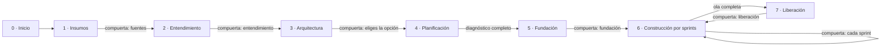

# Modernia

[English](README.md) · **Español**

Modernia es un framework multiagente para modernizar sistemas, empaquetado como
plugin de [Claude Code](https://claude.com/claude-code). Le das un sistema
legado como código fuente, documentación o ambos, en cualquier tecnología. Un
equipo de agentes especialistas lo analiza, te propone arquitecturas destino
para que elijas, planifica el trabajo, lo construye historia por historia con
los tests primero y prepara cada liberación. Tú apruebas cada decisión
importante.

## El equipo

| Agente | Rol |
|---|---|
| **Administrador** | Lleva el proceso, despacha a los agentes, te trae sus preguntas y te pide aprobación en cada compuerta. Es el único que habla contigo. |
| **Scrum Master** | Lleva el tablero, el backlog y los sprints, y cuida que cada regla de negocio quede trazada a una historia. |
| **Analista de proyecto** | Reconoce de qué está hecho el sistema: tecnologías, componentes, integraciones, tamaño y deuda técnica. |
| **Analista de negocio** | Reconstruye capacidades, procesos y reglas de negocio, y encuentra contradicciones entre documentos y código. |
| **Ingeniero de datos** | Reconstruye el modelo de datos y la matriz CRUD, y después construye y valida la migración de datos. |
| **Arquitecto** | Propone 2 o 3 opciones destino puntuadas con criterios explícitos y después documenta la que elijas (ADR, arquitectura destino, olas de migración). |
| **Diseñador UX** | Convierte las pantallas legadas en especificaciones de pantallas modernas y accesibles. |
| **QA** | Define los casos dorados que prueban la equivalencia con el sistema legado y escribe los tests que fallan antes de que exista el código. |
| **Desarrollador** | Implementa cada historia hasta que los tests de QA pasan, sin tocarlos. |
| **Revisor** | Revisa cada historia con contexto fresco y solo lectura, contra sus criterios, sus reglas y la arquitectura. |
| **Seguridad** | Modelo de amenazas, revisión de seguridad por historia, cierre de la deuda de seguridad legada y veredicto GO/NO-GO antes de cada liberación. |
| **DevOps** | CI/CD, contenedores, infraestructura como código, runbooks, planes de vuelta atrás y, con tu aprobación explícita, el despliegue. |

## Cómo funciona



- **Cualquier tecnología.** No hay nada fijo: VB6, COBOL, PowerBuilder, Delphi, Oracle Forms, ASP clásico, .NET Framework, Java EE, PHP, Access… El analista de proyecto descubre el stack en lugar de suponerlo.
- **Código, documentos o ambos.** Sin código, los agentes reconstruyen el sistema a partir de manuales, especificaciones, minutas y capturas (Word, Excel, PowerPoint, PDF, imágenes, texto) y dicen con claridad qué sigue sin saberse. Con las dos fuentes, las **cruzan** y reportan cada contradicción.
- **Sin stack por defecto.** El arquitecto propone opciones según el negocio, los datos y tus restricciones (nube, conocimientos del equipo, tiempos, licencias), y **tú eliges**.
- **Evidencia en cada hallazgo.** Cada regla o dato cita de dónde sale (una línea de código, una sección de un documento o tu respuesta) o queda marcado como supuesto con su nivel de confianza.
- **Tests primero, roles separados.** QA escribe los tests, el desarrollador los hace pasar, y el revisor y seguridad revisan el resultado. Ningún agente aprueba su propio trabajo.
- **Puedes parar cuando quieras.** Al terminar la fase 4 tienes un diagnóstico completo (assessment, arquitectura destino y backlog). Algunos proyectos solo necesitan eso.

### Cómo se comunican los agentes

Los agentes no conversan entre sí. Trabajan sobre un **pizarrón** compartido y
versionable dentro de tu proyecto, la carpeta `.modernia/`. Cada agente lee lo
que dejaron los anteriores y escribe su entregable. El Scrum Master lleva el
tablero, y las preguntas para ti pasan por una sola cola. Todo queda trazable,
y una futura interfaz podrá mostrarlo en vivo.

```
.modernia/
├── config.json · state.json · board.json · backlog.json · questions.json · events.jsonl
├── sources/        documentos convertidos a texto, métricas del código
├── deliverables/   01-inventory · 02-business · 03-data · 04-architecture/ · 05-backlog
│                   06-ux/ · 07-test-strategy · 08-security · 09-release/ · sprints/ · assessment
└── reviews/        una revisión por historia
```

El sistema modernizado se construye en un repositorio destino aparte, que eliges tú.

## Instalación

Requisitos: [Claude Code](https://claude.com/claude-code) y Node.js 18 o
superior (para los scripts de apoyo, que no tienen dependencias).

```bash
claude plugin marketplace add gvaldesmty1/modernia
claude plugin install modernia@modernia
```

O, dentro de Claude Code: `/plugin marketplace add gvaldesmty1/modernia` y después `/plugin install modernia@modernia`.

## Uso

Abre Claude Code en la carpeta donde quieras guardar el trabajo del proyecto
(puede ser el repositorio legado o una carpeta vacía junto a él):

```
/modernia:modernize
```

El administrador te pregunta el nombre del proyecto, dónde está el código,
dónde están los documentos y el idioma de los entregables (español o inglés).
Después te guía fase por fase. Vuelve a ejecutar el mismo comando para seguir
cuando quieras.

```
/modernia:status
```

Muestra en qué fase está el proyecto, qué hizo cada agente, qué se decidió y
qué preguntas esperan tu respuesta.

## Privacidad

`.modernia/` contiene información derivada del material del cliente. Decide si
debe versionarse antes de hacer commit. Los agentes reportan las credenciales
que encuentran en el código legado solo por su ubicación, nunca por su valor, y
nunca copian datos personales en los entregables. Desplegar siempre requiere tu
aprobación explícita para cada ambiente.

## Hoja de ruta

- [x] Diagnóstico: inventario, negocio, datos, opciones de arquitectura, backlog y assessment
- [x] Construcción: fundación, sprints, tests primero, revisión independiente, seguridad
- [x] Liberación por olas, con runbook y vuelta atrás
- [ ] Interfaz web que muestre el pizarrón en vivo (tablero, agentes, decisiones, preguntas)
- [ ] Ejecución desatendida con el Claude Agent SDK, para CI
- [ ] Sincronización del backlog con Jira y Azure Boards

## Estructura del plugin

```
.claude-plugin/marketplace.json
plugin/
├── .claude-plugin/plugin.json
├── agents/        los 11 especialistas (un archivo Markdown cada uno)
├── skills/        modernize (el administrador) y status
├── reference/     convenciones que comparten todos los agentes
└── scripts/       board.mjs (pizarrón), ingest.mjs (documentos), scan.mjs (métricas del código)
```

## Licencia

[MIT](LICENSE)
