# Modernia

[English](README.md) · **Español**

Modernia es un framework multiagente para modernizar sistemas, empaquetado como
plugin de [Claude Code](https://claude.com/claude-code). Le das un sistema
legado como código fuente, documentación o ambos, en cualquier tecnología. Un
equipo de agentes especialistas lo analiza, te propone arquitecturas destino
para que elijas, planifica el trabajo, lo construye historia por historia con
los tests primero y prepara cada liberación. Tú apruebas cada decisión
importante.

## El equipo

| Agente | Rol |
|---|---|
| **Administrador** | Lleva el proceso, despacha a los agentes, te trae sus preguntas y te pide aprobación en cada compuerta. Es el único que habla contigo. |
| **Scrum Master** | Lleva el tablero, el backlog y los sprints, y cuida que cada regla de negocio quede trazada a una historia. |
| **Analista de proyecto** | Reconoce de qué está hecho el sistema: tecnologías, componentes, integraciones, tamaño y deuda técnica. |
| **Analista de negocio** | Reconstruye capacidades, procesos y reglas de negocio, y encuentra contradicciones entre documentos y código. |
| **Ingeniero de datos** | Reconstruye el modelo de datos y la matriz CRUD, y después construye y valida la migración de datos. |
| **Estimador** | Antes de cualquier diseño, estima tiempo, esfuerzo, equipo y costo en rangos P50/P80 con dos métodos independientes. Refina la estimación cuando se elige la arquitectura. |
| **Arquitecto** | Propone 2 o 3 opciones destino puntuadas con criterios explícitos y después documenta la que elijas (ADR, arquitectura destino, olas de migración). |
| **Diseñador UX** | Convierte las pantallas legadas en especificaciones de pantallas modernas y accesibles. |
| **QA** | Define los casos dorados que prueban la equivalencia con el sistema legado y escribe los tests que fallan antes de que exista el código. |
| **Desarrollador** | Implementa cada historia hasta que los tests de QA pasan, sin tocarlos. |
| **Revisor** | Revisa cada historia con contexto fresco y solo lectura, contra sus criterios, sus reglas y la arquitectura. |
| **Seguridad** | Modelo de amenazas, revisión de seguridad por historia, cierre de la deuda de seguridad legada y veredicto GO/NO-GO antes de cada liberación. |
| **DevOps** | CI/CD, contenedores, infraestructura como código, runbooks, planes de vuelta atrás y, con tu aprobación explícita, el despliegue. |

## Cómo funciona

```mermaid
flowchart LR
  A[0 · Inicio] --> B[1 · Insumos]
  B -->|✔ apruebas el material| C[2 · Entendimiento]
  C -->|✔ apruebas el análisis| X[3 · Estimación]
  X -->|✔ apruebas tiempo, equipo y costo| D[4 · Arquitectura]
  D -->|✔ eliges y apruebas la arquitectura| E[5 · Planificación]
  E -->|✔ apruebas el plan y decides construir| F[6 · Fundación]
  F -->|✔ apruebas el esqueleto| G[7 · Construcción por sprints]
  G -->|✔ aceptas cada sprint| G
  G -->|✔ apruebas la ola| H[8 · Liberación]
  H -->|✔ apruebas la liberación, siguiente ola| G
```



- **Cada fase necesita tu aprobación.** Cada fase termina mostrándote sus resultados y preguntándote si se avanza, y nada sigue sin tu sí explícito. No es solo una recomendación, está forzado: el tablero se niega a cambiar de fase hasta que la actual esté aprobada, las fases avanzan de una en una, y volver a una fase anterior obliga a aprobar de nuevo todas las fases desde ahí.

- **Estimación antes del diseño.** En cuanto se entiende el sistema, y antes de cualquier arquitectura, el estimador te dice cuánto tiempo llevará, con cuántas personas y a qué costo, en rangos (P50 y P80), con su nivel de confianza y todos los supuestos a la vista. Cuando eliges la arquitectura, la estimación se refina ola por ola y se concilia con el backlog.

- **Cualquier tecnología.** No hay nada fijo: VB6, COBOL, PowerBuilder, Delphi, Oracle Forms, ASP clásico, .NET Framework, Java EE, PHP, Access… El analista de proyecto descubre el stack en lugar de suponerlo.
- **Código, documentos o ambos.** Sin código, los agentes reconstruyen el sistema a partir de manuales, especificaciones, minutas y capturas (Word, Excel, PowerPoint, PDF, imágenes, texto) y dicen con claridad qué sigue sin saberse. Con las dos fuentes, las **cruzan** y reportan cada contradicción.
- **Sin stack por defecto.** El arquitecto propone opciones según el negocio, los datos y tus restricciones (nube, conocimientos del equipo, tiempos, licencias), y **tú eliges**.
- **Evidencia en cada hallazgo.** Cada regla o dato cita de dónde sale (una línea de código, una sección de un documento o tu respuesta) o queda marcado como supuesto con su nivel de confianza.
- **Tests primero, roles separados.** QA escribe los tests, el desarrollador los hace pasar, y el revisor y seguridad revisan el resultado. Ningún agente aprueba su propio trabajo.
- **Puedes parar cuando quieras.** Al terminar la fase 3 tienes una estimación, y al terminar la 5 un diagnóstico completo (assessment, estimación, arquitectura destino y backlog). Algunos proyectos solo necesitan eso.
- **El modelo de Claude adecuado para cada tarea.** Modernia no está atado a un solo modelo. Ver abajo.

### El modelo adecuado para cada tarea

En cada encargo, el administrador elige entre Claude **Haiku**, **Sonnet**,
**Opus** y **Fable**, según el rol, la dificultad, el riesgo y el tamaño de esa
tarea en particular.

| Modelo | Perfil | Uso típico |
|---|---|---|
| Haiku | El más rápido y económico | Trabajo mecánico y bien definido: planificar tareas, inventarios chicos, historias simples |
| Sonnet | Equilibrado | La mayor parte del análisis y del código: inventarios, datos, UX, tests, DevOps |
| Opus | Razonamiento profundo | Reglas de negocio, estimación, arquitectura, historias complejas, revisiones |
| Fable | El más capaz | Lo más difícil y de mayor riesgo, y las escaladas cuando otro modelo no alcanzó |

- **Sube** un nivel cuando un resultado no alcanza y **baja** en el trabajo repetitivo que va bien. Nunca abarata la estimación, las opciones de arquitectura, la revisión de reglas de dinero o de autorización, ni la aprobación de seguridad.
- **Tú defines la política**: `balanced` (equilibrada, por defecto), `economy` (económica) o `quality` (máxima calidad). También puedes fijar un modelo para un rol, y cambiar todo esto cuando quieras pidiéndolo ("hazlo más barato", "usa el mejor modelo para la arquitectura").
- **Cada elección queda registrada con su motivo**, y el tablero visual muestra qué modelo usa cada agente.

La política completa está en [plugin/reference/models.md](plugin/reference/models.md).

### Cómo se comunican los agentes

Los agentes no conversan entre sí. Trabajan sobre un **pizarrón** compartido y
versionable dentro de tu proyecto, la carpeta `.modernia/`. Cada agente lee lo
que dejaron los anteriores y escribe su entregable. El Scrum Master lleva el
tablero, y las preguntas para ti pasan por una sola cola. Todo queda trazable,
y una futura interfaz podrá mostrarlo en vivo.

```
.modernia/
├── config.json · state.json · board.json · backlog.json · estimate.json · questions.json · events.jsonl
├── sources/        documentos convertidos a texto, métricas del código
├── deliverables/   01-inventory · 02-business · 03-data · 04-estimate · 05-architecture/ · 06-backlog
│                   07-ux/ · 08-test-strategy · 09-security · 10-release/ · sprints/ · assessment
└── reviews/        una revisión por historia
```

El sistema modernizado se construye en un repositorio destino aparte, que eliges tú.

## Instalación

Requisitos: [Claude Code](https://claude.com/claude-code) y Node.js 18 o
superior (para los scripts de apoyo, que no tienen dependencias).

```bash
claude plugin marketplace add gvaldesmty1/modernia
claude plugin install modernia@modernia
```

O, dentro de Claude Code: `/plugin marketplace add gvaldesmty1/modernia` y después `/plugin install modernia@modernia`.

## Uso

Abre Claude Code en la carpeta donde quieras guardar el trabajo del proyecto
(puede ser el repositorio legado o una carpeta vacía junto a él):

```
/modernia:modernize
```

El administrador te pregunta el nombre del proyecto, dónde está el código,
dónde están los documentos y el idioma de los entregables (español o inglés).
Después te guía fase por fase. Vuelve a ejecutar el mismo comando para seguir
cuando quieras.

```
/modernia:status
```

Muestra en qué fase está el proyecto, qué hizo cada agente, qué se decidió y
qué preguntas esperan tu respuesta.

### Tablero visual

```
/modernia:dashboard
```

Abre una página web local (`http://127.0.0.1:4747`) que sigue el proyecto en
vivo mientras los agentes trabajan. Muestra:

- **Resumen**: qué espera tu aprobación, las 8 fases con su estado, los números clave, los agentes trabajando ahora y la actividad reciente;
- **Fases y aprobaciones**: cada aprobación con su nota y fecha, los sprints aceptados y las aprobaciones que se reabrieron;
- **Agentes**: los 13 roles, qué está haciendo cada uno y su última acción;
- **Tablero** y **Backlog y sprints**: tareas e historias en columnas, con el avance por sprint y por épica;
- **Preguntas**: las abiertas (primero las bloqueantes) y las respuestas dadas;
- **Estimación**: los escenarios de equipo con sus rangos P50 → P80 en semanas, horas y costo;
- **Entregables**: cada documento renderizado, con sus diagramas Mermaid;
- **Actividad**: el registro completo, filtrable por agente.

El tablero es de solo lectura: las aprobaciones y respuestas se siguen dando en
Claude Code. No requiere instalación (es un servidor Node sin dependencias que
escucha solo en `127.0.0.1`). Carga el renderizador de Markdown y diagramas
desde un CDN; sin internet, los documentos se muestran como texto. También se
puede abrir a mano con `node plugin/ui/server.mjs --ws <ruta>/.modernia --open`.
Agrega `?static` a la URL para ver una instantánea sin conexión en vivo (para
imprimir o capturar).

## Privacidad

`.modernia/` contiene información derivada del material del cliente. Decide si
debe versionarse antes de hacer commit. Los agentes reportan las credenciales
que encuentran en el código legado solo por su ubicación, nunca por su valor, y
nunca copian datos personales en los entregables. Desplegar siempre requiere tu
aprobación explícita para cada ambiente.

## Hoja de ruta

- [x] Diagnóstico: inventario, negocio, datos, opciones de arquitectura, backlog y assessment
- [x] Estimación de tiempo, equipo y costo antes del diseño, refinada después de la arquitectura
- [x] Construcción: fundación, sprints, tests primero, revisión independiente, seguridad
- [x] Liberación por olas, con runbook y vuelta atrás
- [x] Tablero visual en vivo, de solo lectura (fases, agentes, tablero, backlog, preguntas, estimación, entregables)
- [ ] Aprobar fases y responder preguntas desde el tablero visual
- [ ] Ejecución desatendida con el Claude Agent SDK, para CI
- [ ] Sincronización del backlog con Jira y Azure Boards

## Estructura del plugin

```
.claude-plugin/marketplace.json
plugin/
├── .claude-plugin/plugin.json
├── agents/        los 12 especialistas (un archivo Markdown cada uno)
├── skills/        modernize (el administrador), status y dashboard
├── ui/            el tablero visual: server.mjs y public/
├── reference/     convenciones que comparten todos los agentes y la política de modelos
└── scripts/       board.mjs (pizarrón), ingest.mjs (documentos), scan.mjs (métricas del código)
```

## Licencia

[MIT](LICENSE)
