# Modernia

**English** · [Español](README.es.md)

Modernia is a multi-agent framework for modernizing software systems, packaged
as a [Claude Code](https://claude.com/claude-code) plugin. You give it a legacy
system as source code, documentation or both, in any technology. A team of
specialist agents analyzes it, proposes target architectures for you to choose
from, plans the work, builds it story by story with tests first, and prepares
each release. You approve every important decision.

## The team

| Agent | Role |
|---|---|
| **Administrator** | Runs the process, dispatches the agents, relays their questions and asks for your approval at each gate. It is the only one who talks to you. |
| **Scrum Master** | Owns the board, the product backlog and the sprints, and keeps every business rule traced to a story. |
| **Project Analyst** | Recognizes what the system is made of: technologies, components, integrations, size and technical debt. |
| **Business Analyst** | Reconstructs capabilities, processes and business rules, and finds contradictions between documents and code. |
| **Data Engineer** | Reconstructs the data model and the CRUD matrix, then builds and validates the data migration. |
| **Estimator** | Before any design, estimates time, effort, team and cost as P50/P80 ranges with two independent methods. Refines the estimate once the architecture is chosen. |
| **Architect** | Proposes 2 or 3 target options scored against explicit criteria, then documents your choice (ADR, target architecture, migration waves). |
| **UX Designer** | Turns legacy screens into modern, accessible screen specifications. |
| **QA Engineer** | Defines the golden cases that prove equivalence with the legacy system, and writes the failing tests before the code exists. |
| **Developer** | Implements each story until QA's tests pass, without touching them. |
| **Reviewer** | Reviews each story with fresh context and read-only access, against its criteria, its rules and the architecture. |
| **Security Engineer** | Threat model, per-story security review, closure of the legacy security debt, and a GO/NO-GO verdict before each release. |
| **DevOps Engineer** | CI/CD, containers, infrastructure as code, runbooks, rollback plans and, with your explicit approval, deployment. |

## How it works

```mermaid
flowchart LR
  A[0 · Setup] --> B[1 · Intake]
  B -->|✔ you approve the material| C[2 · Understanding]
  C -->|✔ you approve the analysis| X[3 · Estimation]
  X -->|✔ you approve time, team and cost| D[4 · Architecture]
  D -->|✔ you choose and approve the architecture| E[5 · Planning]
  E -->|✔ you approve the plan and decide to build| F[6 · Foundation]
  F -->|✔ you approve the skeleton| G[7 · Build by sprints]
  G -->|✔ you accept each sprint| G
  G -->|✔ you approve the wave| H[8 · Release]
  H -->|✔ you approve the release, next wave| G
```



- **Every phase needs your approval.** Each phase ends by showing you its results and asking whether to move on, and nothing advances without your explicit yes. This is enforced, not just recommended: the board refuses to change phase until the current one is approved, phases advance one at a time, and going back to an earlier phase means approving every phase again from there.

- **Estimate before design.** As soon as the system is understood, and before any architecture, the estimator tells you how long it will take, with how many people and at what cost, as ranges (P50 and P80) with its confidence level and every assumption visible. After you choose the architecture, the estimate is refined wave by wave and reconciled with the backlog.

- **Any technology.** Nothing is hardcoded: VB6, COBOL, PowerBuilder, Delphi, Oracle Forms, classic ASP, .NET Framework, Java EE, PHP, Access… The project analyst discovers the stack instead of assuming it.
- **Code, documents or both.** Without code, the agents reconstruct the system from manuals, specifications, minutes and screenshots (Word, Excel, PowerPoint, PDF, images, text) and say clearly what remains unknown. With both, they **cross-check** the sources and report each contradiction.
- **No default stack.** The architect proposes options based on the business, the data and your constraints (cloud, team skills, time, licensing), and **you choose**.
- **Evidence on every finding.** Each rule or fact cites where it comes from (a code line, a document section or your answer) or is marked as an assumption with its confidence level.
- **Tests first, separate roles.** QA writes the tests, the developer makes them pass, and the reviewer and the security engineer check the result. No agent approves its own work.
- **Stop whenever you want.** After phase 3 you have an estimate, and after phase 5 a complete diagnosis (the assessment, the estimate, the target architecture and the backlog). Some projects need only that.

### How the agents communicate

The agents do not chat with each other. They work on a shared, versioned
**blackboard** inside your project, the `.modernia/` folder. Each agent reads
what the previous ones left there and writes its deliverable. The scrum master
keeps the board, and questions for you go through a single queue. Everything is
traceable, and a future UI can show it live.

```
.modernia/
├── config.json · state.json · board.json · backlog.json · estimate.json · questions.json · events.jsonl
├── sources/        documents converted to text, code metrics
├── deliverables/   01-inventory · 02-business · 03-data · 04-estimate · 05-architecture/ · 06-backlog
│                   07-ux/ · 08-test-strategy · 09-security · 10-release/ · sprints/ · assessment
└── reviews/        one review per story
```

The modernized system is built in a separate target repository that you choose.

## Installation

Requirements: [Claude Code](https://claude.com/claude-code) and Node.js 18 or
later (for the helper scripts, which have no dependencies).

```bash
claude plugin marketplace add gvaldesmty1/modernia
claude plugin install modernia@modernia
```

Or, inside Claude Code: `/plugin marketplace add gvaldesmty1/modernia`, then `/plugin install modernia@modernia`.

## Usage

Open Claude Code in the folder where you want to keep the project's work (it
can be the legacy repository or an empty folder next to it):

```
/modernia:modernize
```

The administrator asks for the project's name, where the code is, where the
documents are and the language for the deliverables (English or Spanish). Then
it guides you phase by phase. Run the same command again to continue at any
time.

```
/modernia:status
```

Shows where the project is, what each agent did, what was decided and which
questions are waiting for you.

## Privacy

`.modernia/` contains information derived from the client's material. Decide
whether it should be versioned before committing it. The agents report
credentials found in legacy code by location only, never by value, and they
never copy personal data into deliverables. Deployment always requires your
explicit approval for each environment.

## Roadmap

- [x] Diagnosis: inventory, business, data, architecture options, backlog and assessment
- [x] Estimation of time, team and cost before the design, refined after the architecture
- [x] Build: foundation, sprints, tests first, independent review, security
- [x] Release by waves, with runbook and rollback
- [ ] Web UI that shows the blackboard live (board, agents, decisions, questions)
- [ ] Headless runner with the Claude Agent SDK, for CI
- [ ] Sync of the backlog with Jira and Azure Boards

## Plugin structure

```
.claude-plugin/marketplace.json
plugin/
├── .claude-plugin/plugin.json
├── agents/        the 12 specialists (one Markdown file each)
├── skills/        modernize (the administrator) and status
├── reference/     conventions shared by every agent
└── scripts/       board.mjs (blackboard), ingest.mjs (documents), scan.mjs (code metrics)
```

## License

[MIT](LICENSE)
